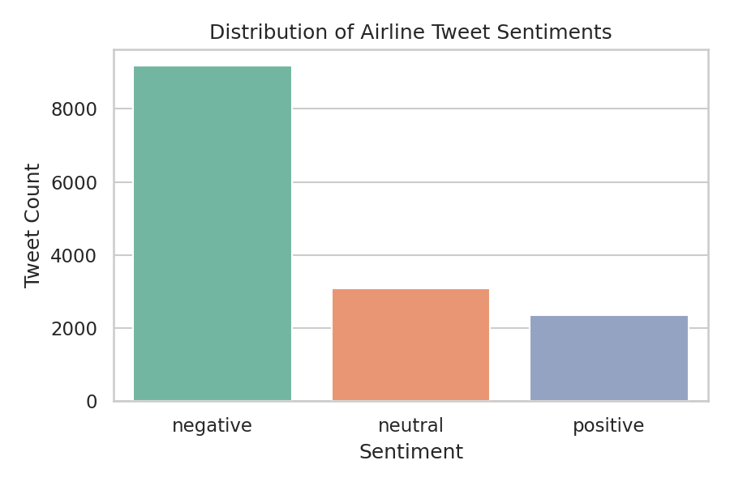
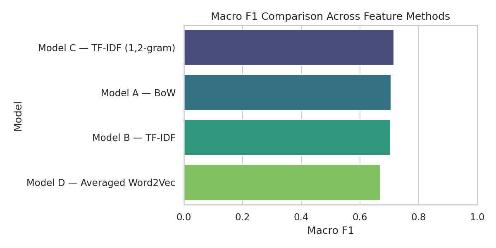

# ✈️ Airline Tweets Sentiment Analysis (NLP)

An end-to-end Natural Language Processing project focused on analyzing sentiment in airline-related tweets. The project explores text preprocessing, sentiment analysis, and visualization of customer opinions through an interactive Streamlit application.

## 🚀 Live Application

Explore the deployed application:

[**Open Airline Tweets Sentiment Analysis App**](https://airline-tweets-sentiment-nlp-bqbrka9gappe8vt5sggtkim.streamlit.app/)

## 🎥 Video Walkthrough

Watch the complete project walkthrough, including implementation and project demonstrations:

[**View Project Walkthrough (Google Drive)**](https://drive.google.com/drive/folders/1dGRbkX3g0iGDDoTr5An1ApJiAhIlFq3G?usp=sharing)

## 📌 Project Overview

The objective of this project is to analyze airline-related tweets and understand customer opinions through sentiment analysis.

The project focuses on:
- Processing and cleaning textual data.
- Preparing text for Natural Language Processing.
- Exploring sentiment patterns in airline tweets.
- Extracting meaningful insights from customer feedback.
- Presenting the analysis through visualizations and an interactive application.

## 🧠 NLP Workflow

1. Data Loading and Exploration
2. Text Cleaning and Preprocessing
3. Exploratory Data Analysis (EDA)
4. Text Representation and Feature Extraction
5. Sentiment Analysis
6. Result Visualization
7. Interactive Application Deployment

## 📊 Project Visualizations

Visualizations generated during the project are stored in the `outputs/` directory.

<p align="center">
  
  
</p>

## 🛠️ Technologies Used

- Python
- Pandas
- NumPy
- Natural Language Processing (NLP)
- Scikit-learn
- Matplotlib / Seaborn
- Streamlit

## 📂 Project Structure

```text
Airline-Tweets-Sentiment-NLP/
│
├── outputs/             # Generated plots and visualizations
├── app.py               # Streamlit application
├── requirements.txt     # Project dependencies
└── README.md
```

## ⚙️ Run Locally

Clone the repository:

```bash
git clone https://github.com/Deepvejpara/Airline-Tweets-Sentiment-NLP.git
```

Navigate to the project directory:

```bash
cd Airline-Tweets-Sentiment-NLP
```

Install dependencies:

```bash
pip install -r requirements.txt
```

Run the Streamlit application:

```bash
streamlit run app.py
```

## 👨‍💻 Author

**Deep Vejpara**

- GitHub: [@Deepvejpara](https://github.com/Deepvejpara)

---

⭐ If you find this project interesting, consider giving the repository a star!
